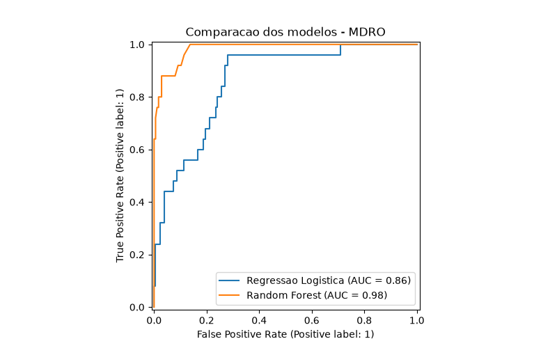

# Predição de Risco de Organismos Multirresistentes em Pacientes de UTI

## Sobre o projeto

Este projeto de pesquisa explora a aplicação de técnicas de Machine Learning para estimar o risco de colonização ou infecção por organismos multirresistentes (MDRO) em pacientes admitidos em Unidades de Terapia Intensiva (UTI).

A proposta é investigar como dados clínicos, demográficos e laboratoriais podem ser utilizados para desenvolver modelos preditivos capazes de auxiliar na identificação precoce de pacientes com maior risco.

O estudo é baseado na metodologia de um artigo científico publicado em 2024, buscando adaptar sua abordagem à realidade de um ambiente hospitalar brasileiro.

## Objetivos

- Investigar a aplicação de Machine Learning na predição de risco de MDRO.
- Explorar variáveis clínicas e epidemiológicas relevantes.
- Desenvolver e comparar modelos de classificação.
- Avaliar o desempenho dos modelos por meio de métricas estatísticas.

## Tecnologias utilizadas

- Python
- NumPy
- Pandas
- SciPy
- Scikit-learn
- Matplotlib

## Metodologia

O desenvolvimento está dividido nas seguintes etapas:

1. Levantamento das variáveis disponíveis no ambiente hospitalar.
2. Estudo da metodologia do artigo científico de referência.
3. Preparação e análise exploratória dos dados.
4. Desenvolvimento de modelos de Machine Learning.
5. Avaliação e comparação dos resultados.

Entre os algoritmos explorados inicialmente estão Regressão Logística e Random Forest.

## Situação atual

O projeto encontra-se na fase de prototipagem metodológica. Inicialmente, foi desenvolvido um script em Python utilizando dados sintéticos para testar o fluxo de preparação, treinamento e avaliação dos modelos.

As próximas etapas envolvem a adaptação da metodologia a uma base histórica hospitalar, mediante autorização institucional e utilização de dados adequadamente protegidos.

## Resultados

### Comparação entre os modelos

A curva ROC apresenta a comparação do desempenho dos modelos de Regressão Logística e Random Forest utilizando dados sintéticos.

## Objetivo futuro

Investigar o potencial de uma solução de apoio à decisão clínica baseada em dados, contribuindo para a identificação de pacientes com maior risco de MDRO na admissão à UTI.

**Importante:** este projeto possui finalidade acadêmica e experimental. O protótipo ainda não foi validado clinicamente e não deve ser utilizado para orientar decisões médicas.

## Referência científica

Li et al. (2024). *Development and validation of machine learning models to predict MDRO colonization or infection on ICU admission by using electronic health record data.*

[Consultar artigo científico](https://doi.org/10.1186/s13756-024-01428-y)

